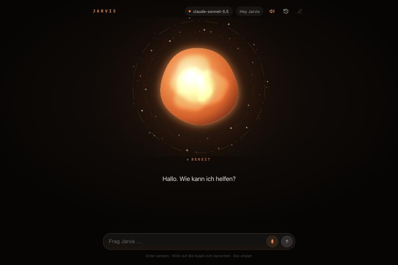

<div align="center">
  
  <h1>Jarvis</h1>
  <p><strong>Dein persönlicher KI-Assistent im Browser.</strong><br>Eine leuchtende Kugel, die zuhört, nachdenkt und antwortet – per Text oder Stimme.</p>
  <p><a href="https://jannickspielt.github.io/jarvis/"><b>▶ Jarvis jetzt öffnen</b></a></p>
  
  <p>
    
    
    
    <a href="https://github.com/JannickSpielt/jarvis/releases/latest"></a>
  </p>
</div>

---

## Was Jarvis kann

Jarvis verbindet verschiedene KI-Dienste mit einer eigenen, bewusst reduzierten Oberfläche. Du kannst chatten, sprechen oder Antworten vorlesen lassen. Die animierte Kugel zeigt, was gerade passiert.

| Funktion | Beschreibung |
| --- | --- |
| **KI-Chat** | Live-Antworten und gespeicherte Gespräche |
| **Spracheingabe** | Mit Jarvis sprechen, statt alles einzutippen |
| **Sprachausgabe** | Antworten Satz für Satz mit einer Stimme deines Geräts vorlesen |
| **Wake Word** | Optional auf „Hey Jarvis“ reagieren |
| **Bildgenerierung** | Bilder über OpenRouter, OpenAI oder Mage.space erstellen |
| **Modellauswahl** | Unterschiedliche Anbieter mit eigenen API-Schlüsseln verwenden |
| **Lokale KI** | Unterstützte lokale Dienste wie Ollama, LM Studio, Jan, llama.cpp, vLLM und LocalAI nutzen |

### Unterstützte KI-Anbieter

Jarvis unterstützt unter anderem:

- **Aggregatoren und Gateways:** OpenRouter, Requesty, Vercel AI Gateway, Eden AI und Hugging Face
- **Direkte Anbieter:** OpenAI, Anthropic, Google Gemini, Groq, Mistral, DeepSeek und xAI
- **Lokale Dienste:** Ollama, LM Studio, Jan, llama.cpp, vLLM und LocalAI

Die verfügbaren Modelle hängen vom jeweiligen Anbieter, deinem API-Key und dessen Kontingent ab.

## Direkt loslegen

1. **[Jarvis öffnen](https://jannickspielt.github.io/jarvis/)**
2. Oben rechts die Einstellungen bzw. den Modellnamen öffnen.
3. Einen Anbieter auswählen und den passenden API-Key hinterlegen.
4. Eine Nachricht schreiben oder auf die Kugel tippen und sprechen.

Für die Nutzung eines Cloud-Anbieters benötigst du einen eigenen API-Key. Abrechnung und Nutzungslimits richten sich nach dem jeweiligen Anbieter.

## Auf deinen Geräten

### Als Web-App installieren

- **iPhone / iPad:** In Safari *Teilen → Zum Home-Bildschirm*
- **Mac:** In Safari *Ablage → Zum Dock hinzufügen*
- **Chrome:** *Menü → Streamen, speichern und teilen → Seite als App installieren*

### Desktop-App für Mac und Windows

**[Neueste Desktop-Version herunterladen](https://github.com/JannickSpielt/jarvis/releases/latest)**

Die Desktop-App lädt beim Start die aktuelle Jarvis-Version und kann lokale KI-Dienste direkt erreichen.

- **macOS:** DMG herunterladen und die App installieren. Da die App nicht von Apple signiert ist, kann macOS beim ersten Start eine Sicherheitsmeldung anzeigen.
- **Windows:** Setup-Datei herunterladen und ausführen. Windows SmartScreen kann bei nicht signierten Installern eine Warnung anzeigen.

Die Spracheingabe kann in der Windows-App eingeschränkt sein. Chat und Sprachausgabe stehen weiterhin zur Verfügung.

### Lokale KI am Mac

Für die Verbindung zu lokalen Diensten wie Ollama gibt es zusätzlich die Mac-Version. Sie stellt Jarvis lokal unter localhost:4180 bereit und umgeht damit Einschränkungen, die Safari bei direkten lokalen Verbindungen haben kann.

Einrichtung im Terminal:

```bash
curl -fsSL https://jannickspielt.github.io/jarvis/mac/install.sh | bash
```

Anschließend Jarvis öffnen und in den Einstellungen den lokalen Anbieter auswählen.

Entfernen:

```bash
launchctl bootout gui/$(id -u) ~/Library/LaunchAgents/com.jannick.jarvis-local.plist
rm -rf ~/Library/LaunchAgents/com.jannick.jarvis-local.plist "$HOME/Library/Application Support/Jarvis"
```

## Datenschutz

Jarvis ist so aufgebaut, dass deine Zugangsdaten und Gespräche nicht über einen eigenen Jarvis-Server laufen.

- API-Keys werden lokal im Browser bzw. in der jeweiligen App-Umgebung gespeichert.
- Bei Cloud-Modellen gehen deine Anfragen direkt an den ausgewählten KI-Anbieter.
- Gespräche und Einstellungen werden lokal gespeichert.
- Bei lokaler KI werden Anfragen an den von dir eingerichteten lokalen Dienst gesendet.
- Spracheingabe verwendet die Spracherkennung des Browsers bzw. Betriebssystems. Je nach Plattform kann dafür ein externer Spracherkennungsdienst eingesetzt werden.

**Wichtig:** Ein API-Key ist ein Zugangsschlüssel zu deinem Anbieter-Konto. Teile ihn nicht und verwende auf gemeinsam genutzten Geräten keine dauerhaft gespeicherten Zugangsdaten.

## Hinweise und Grenzen

- Auf iPhone und iPad steht derzeit nur OpenRouter als KI-Anbieter zur Verfügung. Lokale KI-Dienste wie Ollama laufen dort nicht direkt.
- Bildgenerierung ist in der Desktop-App und der Mac-Version vorgesehen.
- Sprachfunktionen hängen von Browser, Betriebssystem, Mikrofonfreigabe und verfügbaren Stimmen ab.
- Verfügbarkeit, Preise und Nutzungslimits der KI-Modelle werden von den jeweiligen Anbietern bestimmt.

## Fehlerbehebung

| Problem | Was du prüfen kannst |
| --- | --- |
| Keine Antwort vom Modell | API-Key, ausgewähltes Modell und Guthaben bzw. Kontingent beim Anbieter prüfen |
| Mikrofon funktioniert nicht | Mikrofonberechtigung und Sprachunterstützung des Browsers prüfen |
| Lokales Modell wird nicht gefunden | Prüfen, ob der lokale KI-Dienst läuft und erreichbar ist |
| Gespräche fehlen | Prüfen, ob Browserdaten gelöscht oder in einem anderen Browser geöffnet wurden |

## Technik

Jarvis besteht im Kern aus einer einzelnen Datei: index.html. HTML, CSS und JavaScript kommen ohne externe Framework-Abhängigkeiten und ohne Build-Schritt aus.

- Die animierte Kugel wird live auf einem Canvas gezeichnet.
- Spracheingabe und Sprachausgabe verwenden die Web Speech APIs.
- Die Oberfläche ist für Touch-Geräte und Desktop-Browser ausgelegt.
- Die Desktop-Version ergänzt den Browser um den Zugriff auf lokale Dienste und App-Updates.

## Entwicklung und Releases

Änderungen am Projekt werden direkt über GitHub gepflegt. Desktop-Versionen und Installationsdateien findest du unter:

**[Alle Releases ansehen](https://github.com/JannickSpielt/jarvis/releases)**

---

<div align="center">
  <sub>Jarvis · Dein Assistent. Deine Anbieter. Deine Entscheidung.</sub>
</div>
